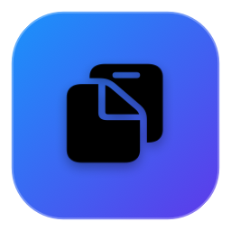

<div align="center">

<p align="center">
  <b>English</b> | <a href="README_CN.md">简体中文</a>
</p>



# 💧 LiquidClip

### The Lightweight, Native Liquid Glass Clipboard History Manager for macOS

<p align="center">
  <a href="https://github.com/Evander-8/LiquidClip/releases/latest">
    
  </a>
  
  
  
  
  
  <a href="LICENSE">
    
  </a>
</p>

<p align="center">
  <a href="https://github.com/Evander-8/LiquidClip/releases/latest">
    
  </a>
</p>

</div>

---

## 💡 Why LiquidClip?

Most clipboard managers available today fall into one of two extremes:
- **Bloated Electron / Web apps** that consume 200MB+ RAM, take seconds to launch, and drain your battery;
- **Clunky legacy menu bars** that look completely out of place in modern macOS;
- **Expensive subscriptions** charging $15-30/year for basic clipboard utilities, often with questionable cloud syncing.

**LiquidClip is crafted with uncompromising care and pure native engineering:**
Built 100% with **Swift 6 + SwiftUI + AppKit**, zero external dependencies, launching in **0.02s** with a mere **~15MB RAM footprint**. Featuring Apple's native **Liquid Glass (Frosted Acrylic/HUD Vibrancy)** design with specular edge refractions, making clipboard management an absolute pleasure.

---

## ✨ Features

### 🪟 1. Native Liquid Glass Aesthetics
- **Depth Frosted Translucency**: System-level `NSVisualEffectView` HUD background that seamlessly adapts to your desktop wallpaper and Dark/Light appearance.
- **Specular Refraction Edge**: Refined dual-gradient border with liquid reflection highlights along top and edges.
- **Natural Fluid Springs**: Every window reveal, hover state, and tab pill transition is driven by tuned spring dynamics.
- **Discreet Menu Bar Accessory**: Operates quietly in the menu bar with zero Dock clutter (`LSUIElement` supported).

### 📋 2. Smart Multi-format Inspection
LiquidClip doesn't just store raw text—it understands what you copy:
- 📝 **Text**:
  - Live character, word, and line count statistics.
  - Quick transformation tools: **UPPERCASE**, **lowercase**, **Title Case**, and **Strip Whitespace**.
  - Powered by a virtualized asynchronous text engine that renders 50,000+ lines in milliseconds without UI freezes.
- 🖼️ **Images**:
  - Crisp high-resolution thumbnail preview, exact pixel dimensions (e.g., `1920 × 1080`), and file formats.
  - One-click export to your "Downloads" folder, or copy image data directly.
- 🎨 **Color Swatches**:
  - Automatically identifies `#HEX` or `rgb(...)` color codes and generates a vibrant liquid color card.
  - One-click export to **HEX**, **RGB**, or **SwiftUI `Color` code**.
- 🔗 **Web URLs**:
  - Domain host & route breakdown with one-click launch in your default browser.
- 📁 **Files & Folders**:
  - Displays genuine AppKit system file icons, filenames, and parent directories with "Reveal in Finder" action.

### 📂 3. Custom Groups with Permanent Deletion Protection
- **Flexible Organization**: Create named groups like "Code Snippets", "Canned Replies", or "Color Themes" with 21 curated SF Symbols.
- **Zero-Purge Protection**:
  - Items assigned to custom groups are **exempt from maximum history limits** and never roll off.
  - Clicking "Clear History" only wipes transient unfiled clips; **custom grouped items are permanently protected**.
- **Instant Filing**: Right-click any row to archive into a group, or toggle groups directly from the inspector header.

### ⚡ 4. Keyboard-Driven Workflow
- **Global Toggle**: Press <kbd>⌘</kbd> + <kbd>⇧</kbd> + <kbd>V</kbd> anywhere to summon the HUD instantaneously (powered by Carbon API, sub-millisecond response).
- **1-9 Instant Quick Paste**: The top 9 items feature quick numeric badges. Press <kbd>1</kbd> ~ <kbd>9</kbd> to paste directly into your active app without touching the mouse!
- **Instant Search**: Type immediately to search across content, source app names, colors, and filenames.

### 🔒 5. Privacy by Design & 100% Offline
- **Password Manager Shield**: Automatically ignores sensitive concealed types from 1Password, Bitwarden, KeePassXC, Apple Keychain, etc.
- **Zero Telemetry**: All data stays purely on your Mac in `~/Library/Application Support/LiquidClip/`. No analytics, no accounts, no cloud sync, 100% offline.

---

## 📊 Comparison

| Feature / Metric | LiquidClip 💧 | Maccy | Paste | Raycast Clipboard |
| :--- | :---: | :---: | :---: | :---: |
| **Visual Aesthetic** | **Liquid Glass (HUD + Specular)** | Classic Menubar Window | Screen-wide Bottom Cards | Dark/Light Flat Modal |
| **Technology** | **Pure Native Swift 6** | Pure Native Swift | Native Swift | Node.js / React Host |
| **RAM Footprint** | **~15 MB** | ~30 MB | ~120 MB+ | ~160 MB+ |
| **Binary Size** | **~1.8 MB** | ~10 MB | ~50 MB+ | ~80 MB+ |
| **Text Transformations** | **Upper/Lower/Title/Trim** | ❌ None | ❌ None | ⚠️ Multi-step |
| **Color Swatch & Code Gen** | **Live Card + SwiftUI/CSS** | ❌ None | ❌ None | ⚠️ Plain text |
| **Protected Custom Groups** | **Permanent Anti-Purge** | ❌ Pinned Only | ✅ Categorized | ❌ None |
| **Network & Privacy** | **0 Network Requests (Offline)** | 0 Network Requests | ⚠️ iCloud Dependent | ⚠️ Cloud Account |
| **Pricing** | **100% Free & Open Source** | Free / $9.99 Sponsor | $14.99/year Subscription | Free / Team Tier |

---

## ⌨️ Keyboard Shortcuts

| Shortcut | Action | Description |
| :--- | :--- | :--- |
| <kbd>⌘</kbd> + <kbd>⇧</kbd> + <kbd>V</kbd> | **Toggle LiquidClip** | Summon or dismiss the HUD from anywhere |
| <kbd>1</kbd> ~ <kbd>9</kbd> | **Direct Quick Paste** | Instantly paste items 1 through 9 into your active app |
| <kbd>↵</kbd> (Enter) | **Paste Selected** | Paste the currently focused clipboard item |
| <kbd>⌘</kbd> + <kbd>C</kbd> | **Copy Only** | Copy to system pasteboard without auto-pasting |
| <kbd>⌘</kbd> + <kbd>P</kbd> | **Favorite / Pin** | Pin item (pinned items are never deleted during history cleanup) |
| <kbd>↑</kbd> / <kbd>↓</kbd> | **Navigate** | Move highlight up and down through the list |
| <kbd>⌫</kbd> (Backspace) | **Delete Item** | Remove the selected item from history |
| <kbd>Esc</kbd> | **Smart Exit** | Clear search text ➔ dismiss modals ➔ close window |

---

## 🚀 Installation

### Option 1: Pre-built DMG Installer (Recommended)

1. Download `LiquidClip-v1.0.1.dmg` from [**GitHub Releases**](https://github.com/Evander-8/LiquidClip/releases/latest);
2. Double-click the DMG and drag **LiquidClip.app** into your **Applications** folder;
3. Launch LiquidClip and press <kbd>⌘</kbd> + <kbd>⇧</kbd> + <kbd>V</kbd> to begin.

> [!TIP]
> ### macOS Gatekeeper ("Cannot be opened" / "Unverified Developer")
> Because LiquidClip is free open-source software built without an expensive Apple Developer ID certificate ($99/year), macOS Gatekeeper may show a warning upon first launch. You can bypass this in seconds using any of these methods:
> 
> - **Method 1 (Easiest)**: In Finder, open `/Applications`, **Right-click (or Control-click)** `LiquidClip.app`, select **Open**, and click **Open** in the dialog (only required once; macOS remembers your approval permanently).
> - **Method 2**: Double-click the `打不开点我 (解除系统安全拦截).command` helper script bundled directly inside the DMG.
> - **Method 3**: Open Mac **System Settings** -> **Privacy & Security**, scroll to the Security section, and click **Open Anyway**.
> - **Method 4**: Run this one-liner in Terminal to remove the quarantine flag:
>   ```bash
>   xattr -cr /Applications/LiquidClip.app
>   ```

---

### Option 2: Build from Source

Prerequisites: macOS 14.0+, Xcode 15.0+ or Swift 6.0 toolchain.

```bash
# 1. Clone the repository
git clone https://github.com/Evander-8/LiquidClip.git
cd LiquidClip

# 2. Run the build script
./scripts/build_app.sh

# 3. Launch the app
open "dist/LiquidClip.app"
```

To build a standalone DMG installer:
```bash
./scripts/build_app.sh --dmg
```

---

## ⚙️ Accessibility Permissions

- **Auto-Paste**: When you pick an item, LiquidClip simulates a keypress of <kbd>⌘</kbd> + <kbd>V</kbd> to insert text into your active document or input field.
- This requires macOS **Accessibility** permission. If not granted, LiquidClip will gracefully copy the content to your pasteboard and remind you to paste manually.
- Click **⚙️ Settings** -> **Authorize** inside LiquidClip to jump straight to the macOS Settings page.

---

## 📄 License

LiquidClip is released under the [MIT License](LICENSE). Contributions, bug reports, and suggestions are warmly welcome!

<div align="center">
  <sub>Made with 💧 and Swift for macOS by <a href="https://github.com/Evander-8">Evander-8</a></sub>
</div>
