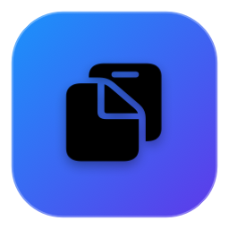

<div align="center">

<p align="center">
  <a href="README.md">English</a> | <b>简体中文</b>
</p>



# 💧 LiquidClip (流光剪贴板)

### 专为 macOS 打造的原生液态玻璃质感、极致轻量、高颜值的剪贴板神器

<p align="center">
  <a href="https://github.com/Evander-8/LiquidClip/releases/latest">
    
  </a>
  
  
  
  
  
  <a href="LICENSE">
    
  </a>
</p>

<p align="center">
  <a href="https://github.com/Evander-8/LiquidClip/releases/latest">
    
  </a>
</p>

</div>

---

## 💡 为什么选择 LiquidClip？

日常开发与办公中，你是否也经历过这些困扰：
- 市面上的剪贴板工具要么基于 **Electron/Web 臃肿迟钝**（动辄占用 200MB 内存、安装包几十 MB）；
- 要么是粗糙古板的传统菜单弹窗，与现代 macOS 的精致设计格格不入；
- 更有甚者采用**昂贵的按月/按年订阅制**，甚至存在联网上传个人隐私的隐患。

**LiquidClip 诞生于对极致工艺与纯粹原生体验的执着：**
坚持纯原生 **Swift 6 + SwiftUI + AppKit** 构建，零第三方依赖，冷启动仅需 **0.02 秒**，常驻内存仅约 **15MB**，搭配 Apple 原生 **液态玻璃（Liquid Glass）折射质感**，让每一次复制与粘贴都成为赏心悦目的操作。

---

## ✨ 核心特性

### 🪟 1. 原生液态玻璃美学 (Liquid Glass Design)
- **多层景深磨砂**：基于系统级 `NSVisualEffectView` HUD 级别半透模糊，完美融入桌面并自动适配布色与壁纸。
- **高光折射微反射边框**：精细的微米级渐变高光轮廓线与顶部液体折射条，真正还原 Apple 精细质感。
- **自然流体动画**：每一次窗口展开、悬浮手势与胶囊切换均由精准调校的弹性动力学驱动。
- **常驻菜单栏配件**：无 Dock 栏驻留（`LSUIElement` 支持），呼之即来、挥之即去。

### 📋 2. 全类型智能内容解析
LiquidClip 不仅仅记录文字，更能理解你复制的内容：
- 📝 **文本 (Text)**：
  - 字符数、词数、行数毫秒级精准统计。
  - 右侧检查器提供一键快捷操作：**转大写**、**转小写**、**首字母大写 (Title Case)**、**清除首尾空白**。
  - 针对长达数万行的代码或日志，采用原生异步虚拟排版引擎，大文本秒级秒开，绝不卡死。
- 🖼️ **图片 (Images)**：
  - 自动渲染高保真高清缩略图，即时检测像素尺寸分辨率（如 `1920 × 1080`）与文件类型。
  - 支持一键导出保存至“下载”文件夹，支持快捷拷贝原图。
- 🎨 **色彩拾取 (Colors)**：
  - 复制 `#4A90E2` 或 `rgb(...)` 等色值时，自动提取并生成鲜艳的液体色盘卡片。
  - 一键复制 **HEX**、**RGB** 或 **SwiftUI `Color` 代码**。
- 🔗 **网络链接 (URLs)**：
  - 自动解析域名与路由，支持一键在系统默认浏览器中打开。
- 📁 **本地文件 (Files)**：
  - 读取真实文件系统图标、名称与所在路径，支持一键“在访达中显示”。

### 📂 3. 专属分组与永久防清理保护 (Custom Groups)
- **创建自定义分组**：可随心建立“常用代码”、“工作回复”、“设计配色”等分组，并随选 21 款精美 SF 图标。
- **防清理守护机制**：
  - 只要移入自定义分组的记录，**永远不受最大历史条数限制**，不会被自动顶替。
  - 点击“清空历史记录”时，系统仅清空未分类的临时碎片，**分组内记录享有永久保护**。
- **极速归档**：右键任意历史记录即可一键移入分组，或在右侧检查器顶部一键切换。

### ⚡ 4. 全键盘极速工作流
- **全局呼出**：随时按下 <kbd>⌘</kbd> + <kbd>⇧</kbd> + <kbd>V</kbd> 瞬间呼出（基于底层 Carbon API，零延迟）。
- **数字直达粘贴**：前 9 条记录配备 <kbd>1</kbd> ~ <kbd>9</kbd> 快捷角标，无需移鼠标，盲打数字瞬间注入目标输入框！
- **秒级模糊搜索**：呼出后直接输入关键字，支持对文本内容、来源应用名称、颜色代码、文件名实时过滤。

### 🔒 5. 严格隐私与纯本地运行
- **敏感信息自动过滤**：原生识别 1Password、Bitwarden、KeePassXC、苹果钥匙串等密码管理器的私密保护类型，坚决不记录密码。
- **零网络、100% 离线**：数据完全保存在本机 `~/Library/Application Support/LiquidClip/`，零遥测、零埋点、零联网权限。

---

## 📊 同类工具横向对比

| 核心维度 | LiquidClip 💧 | Maccy | Paste | Raycast 剪贴板 |
| :--- | :---: | :---: | :---: | :---: |
| **视觉风格** | **液态玻璃 (HUD + 物理高光)** | 传统系统菜单栏浮窗 | 屏幕底部大卡片 | 纯黑/纯白扁平大弹窗 |
| **底层架构** | **纯原生 Swift 6 + SwiftUI** | 纯原生 Swift | 原生 Swift | Node.js / React 宿主 |
| **常驻内存** | **~15 MB** | ~30 MB | ~120 MB+ | ~160 MB+ |
| **安装包大小** | **~1.8 MB** | ~10 MB | ~50 MB+ | ~80 MB+ |
| **文本快速转换** | **大写/小写/首字母/去空** | ❌ 无 | ❌ 无 | ⚠️ 需多步操作 |
| **颜色提取与代码生成** | **实时色盘 + SwiftUI/CSS 生成** | ❌ 无 | ❌ 无 | ⚠️ 纯文本显示 |
| **防误删保护分组** | **专属分组永久防清空** | ❌ 仅全局置顶 | ✅ 分类列表 | ❌ 无独立保护 |
| **网络请求** | **0 网络请求 (纯本地离线)** | 0 网络请求 | ⚠️ 依赖 iCloud 同步 | ⚠️ 账号与云端体系 |
| **授权收费** | **100% 开源免费** | 免费 / $9.99 赞助 | 订阅制 ($14.99/年) | 免费 / 团队订阅 |

---

## ⌨️ 快捷键总览

| 快捷键 | 功能 | 说明 |
| :--- | :--- | :--- |
| <kbd>⌘</kbd> + <kbd>⇧</kbd> + <kbd>V</kbd> | **呼出 / 隐藏** | 全局任意位置瞬间唤起主界面 |
| <kbd>1</kbd> ~ <kbd>9</kbd> | **数字直达粘贴** | 极速将列表前 9 项直接粘贴到当前光标位置 |
| <kbd>↵</kbd> (Enter) | **立即粘贴** | 粘贴当前高亮选中的历史项并隐藏窗口 |
| <kbd>⌘</kbd> + <kbd>C</kbd> | **仅复制** | 拷贝内容到剪贴板，不触发自动键入粘贴 |
| <kbd>⌘</kbd> + <kbd>P</kbd> | **收藏 / 取消收藏** | 标记收藏星标，收藏项不受清空影响 |
| <kbd>↑</kbd> / <kbd>↓</kbd> | **切换项目** | 纯键盘上下浏览历史项目 |
| <kbd>⌫</kbd> (Backspace) | **删除当前项** | 将当前高亮记录从历史中移除 |
| <kbd>Esc</kbd> | **智能退出** | 清空搜索框 ➔ 关闭弹窗 ➔ 隐藏主窗口 |

---

## 🚀 安装指南

### 方式一：下载预编译 DMG 安装包（推荐）

1. 前往 [**GitHub Releases 下载页面**](https://github.com/Evander-8/LiquidClip/releases/latest)，下载最新的 `LiquidClip-v1.0.2.dmg`；
2. 双击打开 DMG，将 **LiquidClip.app** 拖入 **Applications (应用程序)** 文件夹；
3. 打开应用程序中的 `LiquidClip`，按 <kbd>⌘</kbd> + <kbd>⇧</kbd> + <kbd>V</kbd> 即可开始使用。

> [!TIP]
> ### 首次打开提示“无法验证开发者/恶意软件”怎么办？
> macOS 对所有非苹果付费商业证书（$99/年）公证的开源软件默认都会弹出看门人拦截提示。请任选以下一种方法轻松解除：
> 
> - **方法 1（最简单，推荐）**：在访达「应用程序」中，**按住 Control 键点按（或右键）** `LiquidClip.app`，在菜单中选择 **「打开」**，弹出的对话框中再次点击 **「打开」** 即可（只需一次，之后系统会自动信任并直接双击打开）。
> - **方法 2**：双击 DMG 安装包中自带的 **`打不开点我 (解除系统安全拦截).command`** 一键自动解锁。
> - **方法 3**：打开 Mac「系统设置」->「隐私与安全性」，滑到底部“安全性”，点击 **「仍要打开」**。
> - **方法 4**：在终端执行命令解除隔离：`xattr -cr /Applications/LiquidClip.app`。

---

### 方式二：从源码本地构建

环境要求：macOS 14.0+，Xcode 15.0+ 或 Swift 6.0 工具链。

```bash
# 1. 克隆代码仓库
git clone https://github.com/Evander-8/LiquidClip.git
cd LiquidClip

# 2. 运行自动编译打包脚本
./scripts/build_app.sh

# 3. 运行构建产物
open "dist/LiquidClip.app"
```

若需要打包生成 DMG 镜像：
```bash
./scripts/build_app.sh --dmg
```

---

## ⚙️ 辅助功能权限说明

- **自动粘贴体验**：选中历史记录后，LiquidClip 会模拟触发按键 <kbd>⌘</kbd> + <kbd>V</kbd> 自动将内容注入到你当前聚焦的软件中。
- 此特性需要 macOS 的“辅助功能（Accessibility）”权限。首次使用时若未开启，LiquidClip 会先将内容复制到剪贴板，并温和提示你按键粘贴。
- 你可以随时在主界面右上角点击 **⚙️ 偏好设置** ➔ 点击 **「前往授权」**，即可直接跳转至系统设置勾选授权。

---

## 📄 开源许可证

本项目基于 [MIT License](LICENSE) 开源。欢迎 Star、Fork 或提交 Issue / Pull Request 一同完善！

<div align="center">
  <sub>Made with 💧 and Swift for macOS by <a href="https://github.com/Evander-8">Evander-8</a></sub>
</div>
